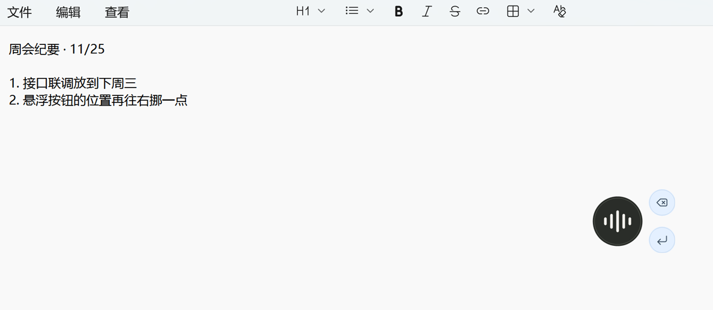

# HexTouch

给 Windows 上的 Hex 听写加上三个触控按钮。轻点主按钮开始说话，再点一下，转写文字就会出现在原来的光标处。右侧两个按钮可以退格和回车，适合没有实体键盘的 Windows 平板。



## 快速开始

1. 安装并配置 [Hex](https://anoma.ly/hex/)，确认可以完成一次听写。HexTouch 通过 Hex 的命令行控制听写，语音模型由 Hex 提供。
2. 在 [Releases](https://github.com/cdacai/hex-touch/releases) 中选择安装包 `HexTouchSetup.exe` 或免安装版 `HexTouch.exe`，也可以按下文从源码构建。运行需要 Windows 和 .NET Framework 4.x。
3. 打开记事本并放好光标。左键点击托盘里的 HexTouch 图标显示悬浮按钮，再点主按钮试说一句。主按钮变红表示正在录音。

## 功能

- 托盘常驻，左键显示 / 隐藏悬浮按钮
- 悬浮按钮三颗：**主球**（录音 / 停止）、**回车**、**删除**
- 点按切换，不需要按住
- 悬浮窗带 `WS_EX_NOACTIVATE`，点击不会夺走输入框焦点
- 双击回车钮 = 插入换行（用剪贴板粘贴，绕过中文输入法吞 `Shift+Enter`）
- 可拖动，位置自动记住
- 开机自启（托盘菜单里勾选）
- 单文件 exe，不依赖 Python、不需要装 .NET SDK，用系统自带的 .NET Framework 4.x

## 安装

### 安装包（推荐）

运行 `HexTouchSetup.exe`：

| 操作 | 命令 |
|---|---|
| 图形安装（可选目录） | 双击 `HexTouchSetup.exe` |
| 静默安装到默认位置 | `HexTouchSetup.exe --silent` |
| 指定路径静默安装 | `HexTouchSetup.exe --silent --dir=D:\Tools\HexTouch` |
| 卸载 | 安装目录下的 `HexTouchUninstall.exe`，或「设置 → 应用」 |

安装会：释放主程序和卸载器 → 写开机自启 → 注册卸载入口 → 立即启动。

默认目录 `%LOCALAPPDATA%\HexTouch\`，装到用户目录，不需要管理员权限。

### 免安装

直接运行 `HexTouch.exe` 即可，不需要安装。首次运行默认启用开机自启动，并保存以下数据：

- `HKCU\Software\Microsoft\Windows\CurrentVersion\Run` 下的自启项（可在托盘菜单里关掉）
- 注册表 `HKCU\Software\HexTouch` 中的首次初始化标记
- exe 同目录的 `hextouch.log` 和 `button.pos`（日志和悬浮按钮位置）

不注册卸载项、不写开始菜单快捷方式。

### 从源码构建

需要 Windows 自带的 .NET Framework 4.x（Win10/11 都有，不用装 SDK）。

```cmd
build.cmd
```

依次生成：

1. `dist\HexTouch.exe` — 主程序
2. `dist\HexTouchUninstall.exe` — 卸载器
3. `dist\HexTouchSetup.exe` — 安装器（把上面两个嵌为资源）

编译器路径自动探测 `Framework64` / `Framework` 下的 `csc.exe`。

改图标后重新生成（只在构建期用 Python）：

```cmd
python tools\gen_icon.py
```

## 使用指南

### 开始一次听写

1. 左键点击系统托盘里的 HexTouch 图标，显示三个悬浮按钮。若找不到图标，可先展开任务栏右侧的隐藏图标。
2. 点击记事本、聊天框或文档中的输入位置，再轻点左侧带音波的大圆。主按钮变成红底白色方块后就可以说话。
3. 说完再点一次主按钮。Hex 会结束听写，把转写文字放到原光标处。

### 编辑、换行和发送

| 按钮 | 手势 | 用途 |
|---|---|---|
| 右上退格键 | 轻点一次 | 向当前应用发送 Backspace，效果与键盘退格相同。 |
| 右下回车键 | 轻点一次 | 向当前应用发送 Enter。在记事本里会换行，在设为「回车发送」的聊天框里会发送消息。 |
| **右下回车键** | **快速连点两次** | **在支持多行粘贴的输入框中插入换行。** 适合聊天时另起一段，继续编辑同一条消息。 |

例如，在「回车发送」的聊天框里，先听写第一段，**双击右下回车键**另起一行，再听写第二段。检查完文字后，**单击同一个回车键**发送整条消息。

回车键会短暂等待第二次点击，因此单击稍有延迟。双击换行会临时借用剪贴板粘贴一个换行符，随后尝试恢复原内容。

### 移动、收起和退出

- **调整位置**：按住左侧主按钮拖动，松手后保存位置。
- **收起或重新显示**：左键点击托盘图标。
- **打开 Hex 或更改自启**：右键点击托盘图标，选择「唤起 Hex 窗口」或「开机自启动」。勾选表示已启用。
- **退出**：「退出 Hex」关闭听写程序并收起悬浮按钮。「退出」关闭 HexTouch 托盘工具，之后可从安装目录或开始菜单重新打开。

## 工作原理

```
托盘图标（NotifyIcon）
   │ 左键点击：显示 / 隐藏
   ▼
悬浮按钮窗口（WinForms，WS_EX_NOACTIVATE，不抢焦点）
   ├─ 主球   → hex dictation start / stop
   ├─ 回车钮 → Enter；双击 = 插入换行
   └─ 删除钮 → Backspace
        │
        ▼
Hex CLI（%APPDATA%\hex\bin\hex.com）
        │
        ▼
Hex 本地模型转写 → 粘贴回原来的光标位置
```

几个关键设计：

- **不模拟"按住热键说话"**：触摸屏上按住会触发 Windows 的长按右键手势，所以改成点按切换
- **窗口带 `WS_EX_NOACTIVATE`**：点击悬浮按钮不会抢走输入框焦点，文字和回车才能落到正确位置
- **只调 Hex 的命令行**：不修改 Hex 本身，也不依赖它的热键
- **失败自愈**：Hex 没运行时点主球会自动拉起 `hex.exe`，约 2 秒后开始录音
- **状态轮询先看进程**：`hex.exe` 不在时跳过 CLI 调用，避免命令挂起把内部队列堵死；悬浮按钮隐藏时也不查录音状态，省掉每轮的进程创建

## 自启与退出

### 开机自启

托盘菜单里的「开机自启动」勾选即写入：

```
HKCU\Software\Microsoft\Windows\CurrentVersion\Run
  值名: HexTouchTray
  值:   <程序绝对路径>
```

也可以命令行关掉：

```cmd
reg delete "HKCU\Software\Microsoft\Windows\CurrentVersion\Run" /v HexTouchTray /f
```

### 启动

```cmd
HexTouch.exe                  :: 启动，托盘出现图标
HexTouch.exe --show-ball      :: 启动并直接显示悬浮按钮
```

### 退出

| 方式 | 说明 |
|---|---|
| 托盘右键 → 退出 | 会弹确认框，并提示怎么重新打开 |
| 托盘右键 → 退出 Hex | 只关 Hex，托盘程序还在（同时收起悬浮按钮） |
| 任务管理器结束进程 | 兜底 |

退出后再打开：双击程序文件，或开始菜单里的 **HexTouch**（安装版才会创建快捷方式）。

### 命令行参数

| 参数 | 作用 |
|---|---|
| `--show-ball` | 启动后立即显示悬浮按钮 |
| `--pos=x,y` | 指定悬浮按钮初始位置（调试用） |
| `--selftest` | 自测：自动录音 4 秒后退出，用于检查 Hex 通路 |

## 托盘图标常驻

Windows 11 默认把新图标放进托盘溢出区（`^`）。第一次显示后：

`设置 → 个性化 → 任务栏 → 其他系统托盘图标` → 把 **HexTouch** 打开。

## 项目结构

```
.
├── src/
│   ├── HexTouch.cs          # 主程序：托盘、悬浮按钮、录音、换行、删除
│   ├── Installer.cs         # 安装器（把主程序和卸载器嵌进一个 exe）
│   └── Uninstaller.cs       # 卸载器（复制到临时目录再删自己）
├── assets/
│   └── app.ico              # 程序图标
├── tools/
│   └── gen_icon.py          # 构建期生成 app.ico（运行时不依赖 Python）
├── build.cmd                # 一键编译三个 exe 到 dist/
└── dist/                    # 编译产物（不入库）
```

运行时会在 exe 同目录生成：

| 文件 | 说明 |
|---|---|
| `hextouch.log` | 运行日志（超 512KB 自动清空） |
| `button.pos` | 悬浮按钮位置记忆（拖过之后才有） |

## 排错

- 看 `hextouch.log`：每次调用 `hex ...` 都会记录命令、退出码和输出摘要
- 托盘图标变灰 = Hex 没在运行；点一下主球会自动把它拉起来（约 2 秒）
- `dictation start failed` 之后会有 `hex app started directly` 和重试记录

## 已知限制

- **只对接 Hex**：程序调用的是 Hex 的命令行（`hex dictation start/stop`）。换成别的听写软件需要另写适配层，目前没有做
- Hex 的 `hex start` 命令在 Hex 未运行时会挂起不返回，所以程序里改为直接启动 `hex.exe` 进程
- 触摸点击存在系统层约 100–300ms 的判定延迟，按下反馈会稍晚
- 只支持 Windows（依赖 WinForms 和 `Shell_NotifyIcon`）

## License

MIT
